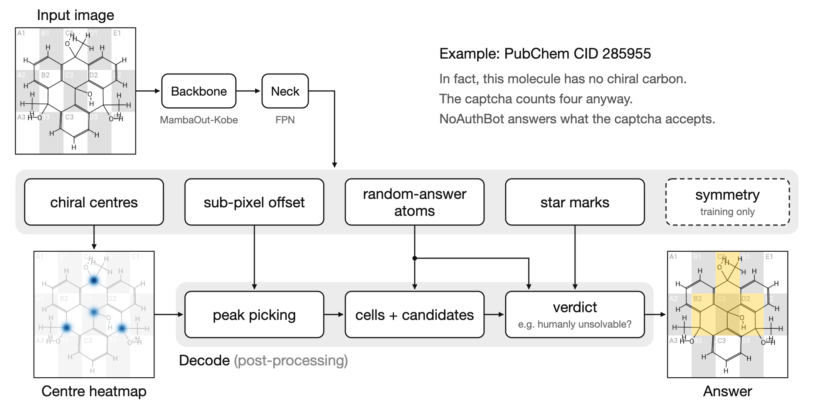

# NoAuthBot



## Quick start

Try our [demo](https://huggingface.co/spaces/catme0w/NoAuthBot) on Hugging Face!

To run the app locally, without cloning the repository:

```bash
uvx --from git+https://github.com/CatMe0w/NoAuthBot noauthbot
```

Requires [uv](https://docs.astral.sh/uv/).

## Model

- Backbone: [MambaOut-Kobe](https://github.com/yuweihao/MambaOut)
- Neck: FPN, 4 levels, channels=64, LayerNorm
- Heads: 5 heads, each 3x3 conv, GELU, 1x1 conv, stride=4
  - Chiral centres (heatmap)
  - Sub-pixel offset
  - Random-answer atoms
  - Star marks
  - Symmetry (training only)

## Setup

To train or evaluate the model, clone this repository:

```bash
git clone https://github.com/CatMe0w/NoAuthBot
cd NoAuthBot
uv sync
```

The images are rendered by the generator's own code, which `harness/` wraps. It requires x86-64 Linux (WSL works) with JDK 17 or later:

```bash
harness/build.sh
```

The script fetches the generator and compiles it alongside the harness.

## Data

Everything is derived from the PubChem Compound SDF files. Download them into `data/pubchem/sdf/`:

```bash
wget -r -nd -np -A 'Compound_*.sdf.gz' -P data/pubchem/sdf https://ftp.ncbi.nlm.nih.gov/pubchem/Compound/CURRENT-Full/SDF/
```

A dataset is then a list of CIDs per set in `data/split/`, and the rendering of each list in `data/rendered/`. There are two ways to get the lists.

### Our lists

To rebuild the dataset we trained and tested on, use our lists:

```bash
curl -LO https://huggingface.co/catme0w/NoAuthBot/resolve/main/noauthbot-data.tar.xz
tar -xJf noauthbot-data.tar.xz
```

It contains the lists (`data/split/`) and the checksums of the SDF files we used (`data/pubchem/files.tsv`). PubChem rewrites its files often, so yours do not have to match.

With the lists in place, [render](#rendering) the sets.

> [!NOTE]
> PubChem occasionally withdraws compounds. When a list contains CIDs that your SDF files no longer have, the renderer continues and saves the missing CIDs. You can then fetch the missing compounds from PubChem:
>
> ```bash
> uv run python -m noauthbot.data.fetch_missing data/rendered/train/_runs/<run>.missing.txt
> ```
>
> This collects them in `data/pubchem/sdf/missing.sdf.gz`. Render the set again to add the missing images.

### Your own lists

To build a dataset from your own snapshot of PubChem:

```bash
scripts/labels.sh
uv run python -m noauthbot.data.split
```

`labels.sh` runs the generator's grading rules over every compound and writes the candidates to `data/labels/`.

`split` assigns the compounds to train, val and test, and writes the lists to `data/split/`. Compounds with the same skeleton never end up in different sets.

### Rendering

```bash
scripts/render.sh train
```

The sets are:

| set | used by |
| --- | --- |
| `train`, `train_amb` | training |
| `val_sub` | the validation during training |
| `val`, `test` | evaluation |
| `val_amb` | evaluation of the ambiguity (random-answer) head |

Each set becomes a directory of `.tar.zst` shards in `data/rendered/<set>/`, with a PNG and a JSON label per image. An interrupted run can be resumed by running the same command again.

## Training

```bash
uv run python -m noauthbot.train configs/full.yaml
```

The run writes to `data/runs/<name>/`, with `<name>` from the config:
- a log
- `last.safetensors` at every validation
- `best.safetensors` at the best one so far
- `stable-<samples>.safetensors` right before the learning rate starts to decay

Pass `--resume` to continue a run from its `last.safetensors`.
 
### Continuing from our checkpoint

`stable-12800000.safetensors` is the full state of our run right before its decay. To continue from it, place it as the last checkpoint of a run, and resume:

```bash
mkdir -p data/runs/full
curl -L -o data/runs/full/last.safetensors https://huggingface.co/catme0w/NoAuthBot/resolve/main/stable-12800000.safetensors
uv run python -m noauthbot.train configs/full.yaml --resume
```

With `configs/full.yaml` as it is, this repeats our decay phase. To train for longer before the decay, raise `samples` in the config first.

`name` and `samples` are the only keys that may differ from the checkpoint's config. The run reads the training data at the position where the checkpoint stopped, so it needs the same lists rendered.

## Evaluation

Download a released model, for example into `data/release/`:

```bash
curl -L --create-dirs -o data/release/noauthbot.safetensors https://huggingface.co/catme0w/NoAuthBot/resolve/main/noauthbot.safetensors
curl -L --create-dirs -o data/release/noauthbot.onnx https://huggingface.co/catme0w/NoAuthBot/resolve/main/noauthbot.onnx
```

`noauthbot.safetensors` is the moving average of the weights after the decay, evaluated on the GPU:

```bash
uv run python -m noauthbot.evaluate data/release/noauthbot.safetensors --set test
```

`noauthbot.onnx` is the same network with int8 weights, evaluated on the CPU:

```bash
uv run python -m noauthbot.evaluate data/release/noauthbot.onnx --set test
```

`--set` picks the set to evaluate: `val_sub` (default), `val` or `test`. Render it first, together with `val_amb`, which every evaluation also uses to measure the ambiguity head.

The result is printed and written next to the model as `<model>_eval_<set>.txt`, with the same numbers in `.json` and one row per image in `.tsv`. Our own results on test are in `results/` on Hugging Face.

---

A checkpoint of your own training can be evaluated in the same way, and can be exported to the int8 ONNX model with:

```bash
uv run --group onnx python -m noauthbot.export data/runs/full/last.safetensors data/runs/full/model.onnx
```

## License

MIT License
